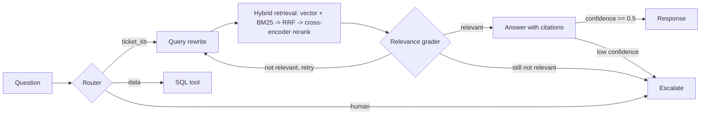

# AI Ticket Analyzer

Multi-agent RAG assistant for IT support tickets. Answers troubleshooting questions with cited sources,
answers analytics questions via SQL, and escalates to a human when confidence is low.

## Architecture



## Stack
Python, LangChain, LangGraph, AWS Bedrock (LLM), ChromaDB, sentence-transformers (embeddings + cross-encoder),
rank-bm25, FastAPI, Streamlit, Docker.

## Techniques
- Hybrid search: vector + BM25 fused with Reciprocal Rank Fusion, then cross-encoder reranking
- 4 chunking strategies compared: fixed, recursive, semantic, parent-child
- Metadata filtering (category), dropped on retry
- Self-corrective RAG: grader + query rewrite loop
- Structured outputs (Pydantic), versioned prompts, citation guardrail
- Read-only SQL tool, human escalation, token and latency tracking

## Evaluation
Ablation over chunking strategy x retrieval mode (hit@1, hit@4, MRR) on a 14-question set.
Data is synthetic. Results: see `eval_results.csv`.

| Chunking | Retrieval | Hit@1 | Hit@4 | MRR |
|---|---|---:|---:|---:|
| Fixed | Vector | 1.00 | 1.00 | 1.00 |
| Fixed | BM25 | 1.00 | 1.00 | 1.00 |
| Fixed | Hybrid | 0.86 | 1.00 | 0.92 |
| Fixed | Hybrid + Rerank | 1.00 | 1.00 | 1.00 |
| Recursive | Vector | 1.00 | 1.00 | 1.00 |
| Recursive | BM25 | 1.00 | 1.00 | 1.00 |
| Recursive | Hybrid | 0.86 | 1.00 | 0.92 |
| Recursive | Hybrid + Rerank | 1.00 | 1.00 | 1.00 |
| Semantic | Vector | 1.00 | 1.00 | 1.00 |
| Semantic | BM25 | 0.93 | 1.00 | 0.96 |
| Semantic | Hybrid | 0.86 | 1.00 | 0.92 |
| Semantic | Hybrid + Rerank | 1.00 | 1.00 | 1.00 |
| Parent-Child | Vector | 1.00 | 1.00 | 1.00 |
| Parent-Child | BM25 | 0.93 | 1.00 | 0.96 |
| Parent-Child | Hybrid | 0.86 | 1.00 | 0.93 |
| Parent-Child | Hybrid + Rerank | 1.00 | 1.00 | 1.00 |

**Note:** Evaluation was performed using 14 test questions on synthetic data. These results are from a small evaluation dataset and should not be interpreted as production-level accuracy.

## Run
```bash
pip install -r requirements.txt
cp .env.example .env        # fill in values
python -m src.generate_data
python -m src.ingest
python -m src.evaluate
streamlit run app.py        # UI
uvicorn api:app --reload    # API (docs at /docs)
```

## Docker
```bash
docker build -t ticket-analyzer .
docker run -p 8501:8501 --env-file .env ticket-analyzer
```
