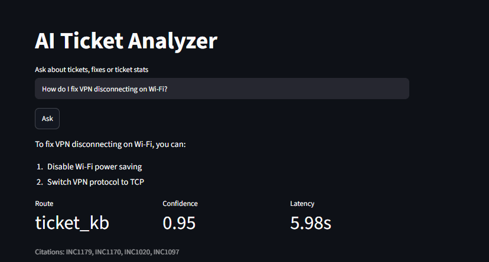
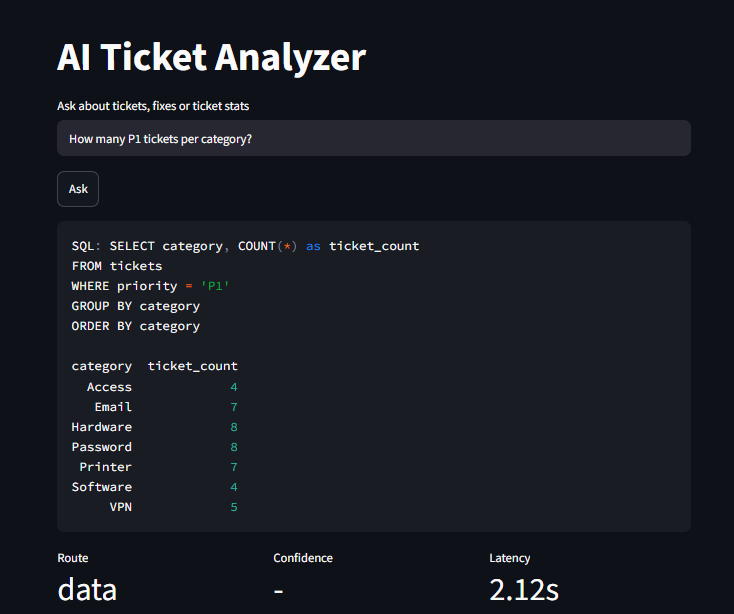
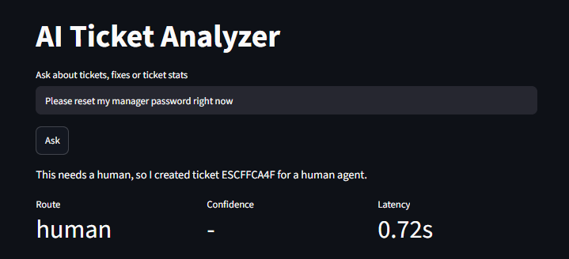
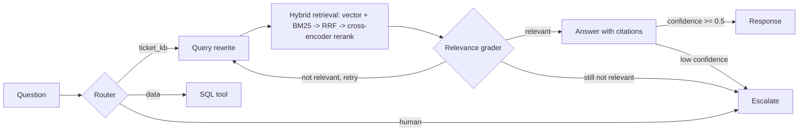

# AI Ticket Analyzer

Multi-agent RAG assistant for IT support tickets. Answers troubleshooting questions with cited sources,
answers analytics questions via SQL, and escalates to a human when confidence is low.

## Demo

**RAG answer with citations**


**SQL route**


**Human escalation**


## Architecture



## Stack
Python, LangChain, LangGraph, AWS Bedrock (Claude Haiku 4.5), ChromaDB, sentence-transformers
(embeddings + cross-encoder), rank-bm25, FastAPI, Streamlit, Docker.

## Techniques
- Hybrid search: vector + BM25 fused with Reciprocal Rank Fusion, then cross-encoder reranking
- 4 chunking strategies compared: fixed, recursive, semantic, parent-child
- Metadata filtering (category), dropped on retry
- Self-corrective RAG: grader + query rewrite loop
- Structured outputs (Pydantic), versioned prompts, citation guardrail
- Read-only SQL tool, human escalation, token and latency tracking

## Evaluation
Ablation over chunking strategy x retrieval mode on a 24-query set (hit@1, hit@4, MRR).

| Chunking | Retrieval | Hit@1 | Hit@4 | MRR |
|---|---|---:|---:|---:|
| Fixed | Vector | 0.96 | 0.96 | 0.96 |
| Fixed | BM25 | 0.92 | 1.00 | 0.95 |
| Fixed | Hybrid | 0.92 | 1.00 | 0.95 |
| Fixed | Hybrid + Rerank | 0.96 | 1.00 | 0.98 |
| Recursive | Vector | 1.00 | 1.00 | 1.00 |
| Recursive | BM25 | 0.92 | 1.00 | 0.95 |
| Recursive | Hybrid | 0.92 | 1.00 | 0.95 |
| Recursive | Hybrid + Rerank | 1.00 | 1.00 | 1.00 |
| Semantic | Vector | 1.00 | 1.00 | 1.00 |
| Semantic | BM25 | 0.88 | 1.00 | 0.93 |
| Semantic | Hybrid | 0.92 | 1.00 | 0.95 |
| Semantic | Hybrid + Rerank | 1.00 | 1.00 | 1.00 |
| Parent-Child | Vector | 1.00 | 1.00 | 1.00 |
| Parent-Child | BM25 | 0.83 | 1.00 | 0.90 |
| Parent-Child | Hybrid | 0.92 | 1.00 | 0.96 |
| Parent-Child | Hybrid + Rerank | 0.96 | 1.00 | 0.97 |

**Findings**
- Cross-encoder reranking improved MRR over plain hybrid (RRF) in every chunking strategy.
- Hybrid + rerank reached 1.00 hit@4 on all four strategies.
- BM25 alone ranks poorly (hit@1 0.83-0.92) but always surfaces the right ticket in the top 4, which makes it a good candidate generator for fusion.
- Vector search is already strong on this dataset, so hybrid retrieval shows no clear gain over it here.

## Notes
- The data is synthetic (200 generated tickets plus a small knowledge base), and the evaluation set is small (24 queries). Each query is worth 0.04, so differences of one or two queries are not significant. Do not read these numbers as production accuracy.
- The agent uses parent-child chunking because it returns the full ticket as context for the LLM, not because it scored highest. Several strategies tied on this dataset.

## Run
```bash
pip install -r requirements.txt
cp .env.example .env        # fill in values
python -m src.generate_data
python -m src.ingest
python -m src.evaluate
streamlit run app.py        # UI
uvicorn api:app --reload    # API (docs at /docs)
```

## Docker
```bash
docker build -t ticket-analyzer .
docker run -p 8501:8501 --env-file .env -v "$HOME/.aws:/root/.aws:ro" ticket-analyzer
```